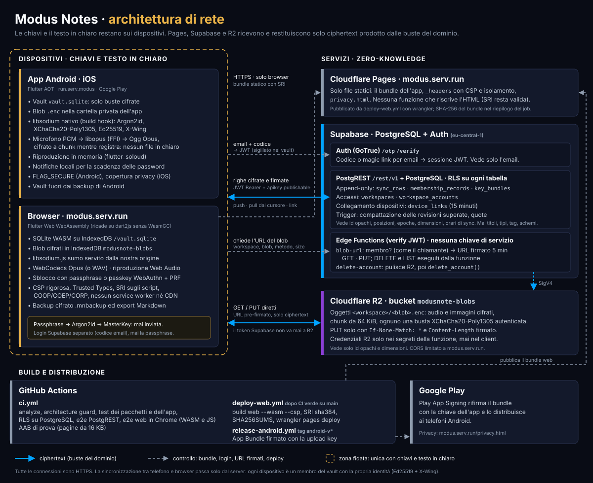
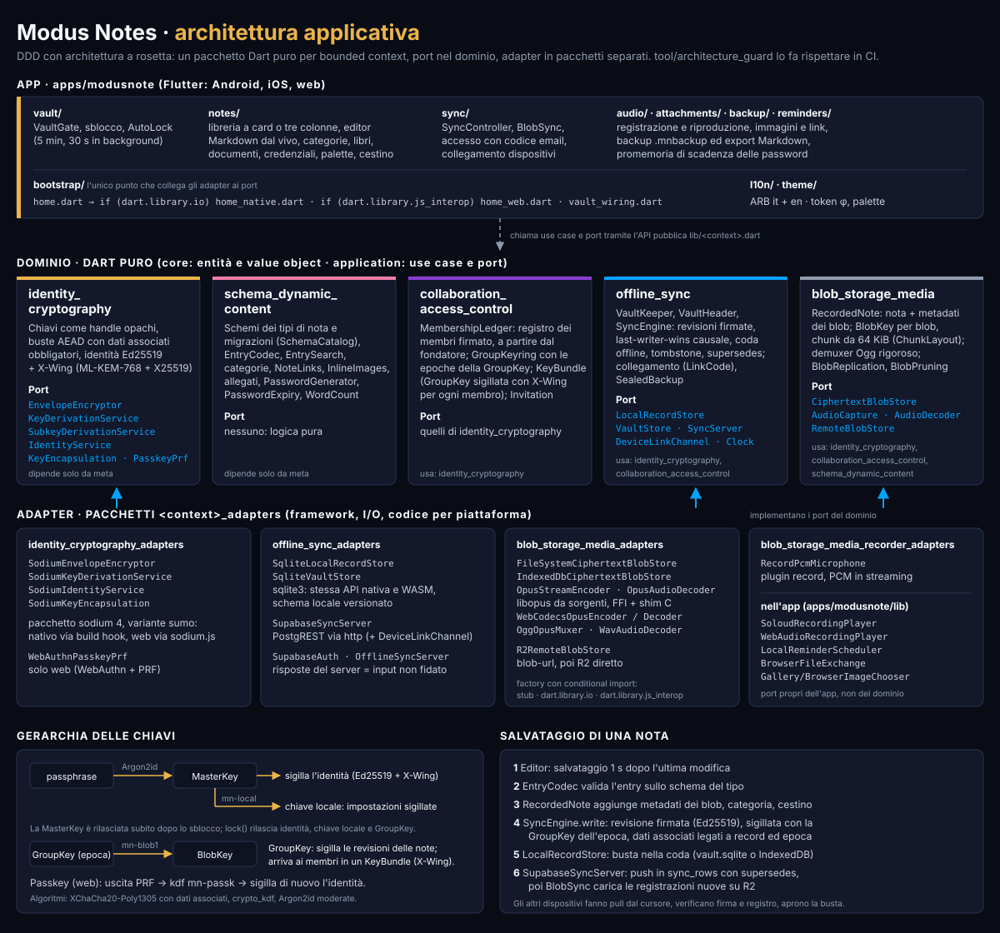

# ModusNote

Note offline-first, cifrate end-to-end, con un motore a schemi dinamici (canzoni, sogni, to-do, note libere) e registrazioni audio cifrate, condivisibili in gruppi a zero-knowledge.

Specifica, architettura e regole di sviluppo: [CLAUDE.md](CLAUDE.md).

## Architettura

### Rete

Telefoni e browser sono gli unici a tenere chiavi e testo in chiaro. Un solo Worker Cloudflare in Rust su `modus.serv.run` serve il client web (Workers Static Assets) e l'API di sincronizzazione sotto `/api/`; i Durable Objects (giurisdizione UE) tengono registro firmato, `KeyBundle`, righe cifrate e codici di invito, e R2 (bucket UE) le registrazioni e le immagini cifrate, raggiunto solo dal Worker. Non ci sono account né email: ogni dispositivo firma ogni richiesta con la propria chiave Ed25519, e il server verifica firme e registro prima di accettare qualcosa, senza mai aprire nulla.



Fino al 23 ottobre 2026 la sincronizzazione passava da Supabase (PostgreSQL, Auth con codice email, Edge Functions) e il client web da Cloudflare Pages: Supabase resta in sola lettura per qualche settimana, poi si spegne; il suo codice non è più nel repository (si ritrova nella cronologia git).

### Applicazione

Un pacchetto Dart puro per bounded context, con i port nel dominio e gli adapter (libsodium, SQLite, il nostro server, libopus, WebCodecs) in pacchetti `_adapters` separati; l'app Flutter li collega in `lib/bootstrap/`. Il server in `server/` riprende gli stessi formati e regole in Rust, e i vettori d'oro in `server/vectors/` controllano che Dart e Rust diano lo stesso esito.



## Avvio rapido

```bash
flutter pub get
dart analyze --fatal-infos
dart run tool/architecture_guard/bin/architecture_guard.dart
(cd apps/modusnote && flutter run)
(cd server && cargo test)                 # server, con i vettori d'oro
bash server/e2e/run.sh                    # il Worker in workerd (DO e R2 locali)
```

## Licenza

Il codice è software libero con licenza [GNU Affero General Public License v3.0](LICENSE): chi lo modifica e lo distribuisce, o lo offre come servizio in rete, deve pubblicare i propri sorgenti con la stessa licenza. Il nome «Modus Notes» e il logo non sono concessi dalla licenza: vedi [NOTICE](NOTICE). Per segnalare una vulnerabilità: [SECURITY.md](SECURITY.md).
